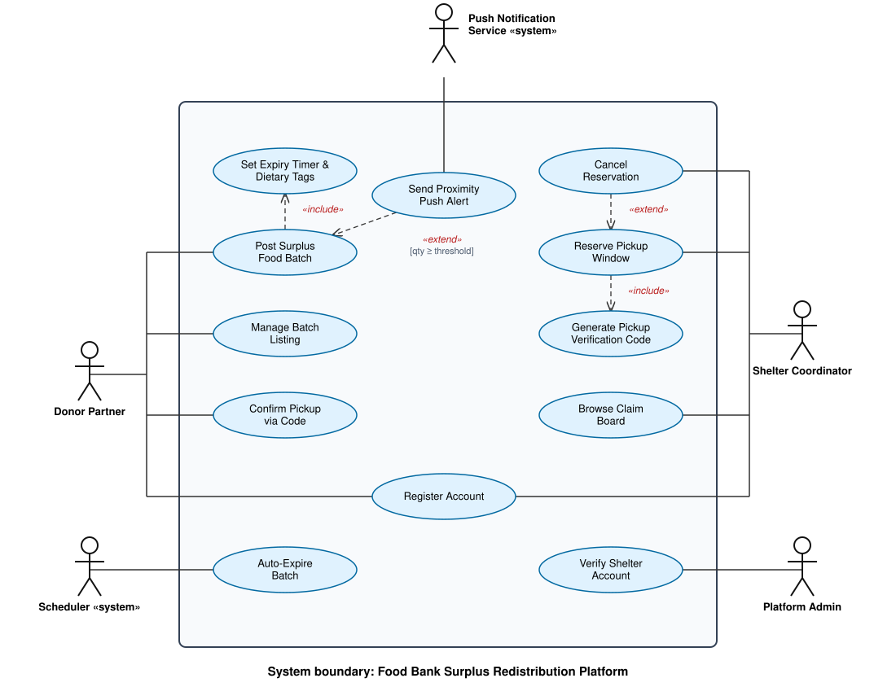

# Food Bank Surplus Redistribution Platform — Lab 1
**Problem Statement #62 · Sustainability & Green Tech · Requirements Engineering & UML Use-Case Modelling**

Restaurants and grocery stores (Donor Partners) post surplus edible food; verified shelters (Shelter Coordinators) reserve pickup windows before the food expires.

| Deliverable | File |
|---|---|
| Requirements table (5 FR + 2 NFR) | [docs/01-requirements.md](docs/01-requirements.md) |
| UML use-case diagram (with «include» and «extend») | [docs/02-use-case-diagram.md](docs/02-use-case-diagram.md) · [SVG](diagrams/usecase-diagram.svg) · [PlantUML](diagrams/usecase-diagram.puml) |
| Use-case flow specification (UC-07 Reserve Pickup Window) | [docs/03-use-case-flow-spec.md](docs/03-use-case-flow-spec.md) |



## Repo layout
```
lab1-uml/
├── README.md
├── docs/        # requirements, diagram notes, flow spec
└── diagrams/    # SVG, PNG, PlantUML source, generator script
```

## Submit
```bash
git init && git add . && git commit -m "Lab 1: requirements + UML use-case model"
git branch -M main
git remote add origin https://github.com/<your-username>/lab1-uml.git
git push -u origin main
```
