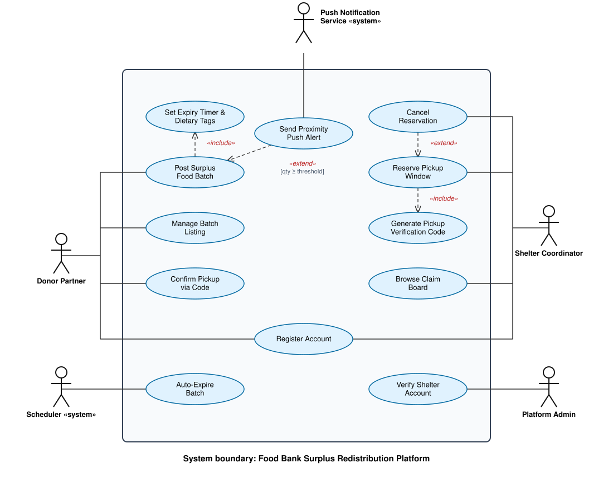

# 2. UML Use-Case Diagram

Sources: [`usecase-diagram.svg`](../diagrams/usecase-diagram.svg) · [`usecase-diagram.puml`](../diagrams/usecase-diagram.puml) (PlantUML, paste into plantuml.com to re-render).

## Actors
| Actor | Role |
|---|---|
| Donor Partner | Restaurant or grocery store that posts, manages, and hands over surplus food |
| Shelter Coordinator | Verified shelter user who browses, reserves, and collects food |
| Platform Admin | Verifies shelter accounts (supporting actor) |
| Push Notification Service | External system (FCM / Web Push) that delivers alerts |
| Scheduler | System timer that expires batches |

## Relationships
| Type | From → To | Why |
|---|---|---|
| «include» | Post Surplus Food Batch → Set Expiry Timer & Dietary Tags | Mandatory step on every posting |
| «include» | Reserve Pickup Window → Generate Pickup Verification Code | A reservation always produces a code |
| «extend» | Send Proximity Push Alert → Post Surplus Food Batch | Only when quantity ≥ threshold (extension point: *after batch published*) |
| «extend» | Cancel Reservation → Reserve Pickup Window | Optional; happens only if the shelter withdraws |
